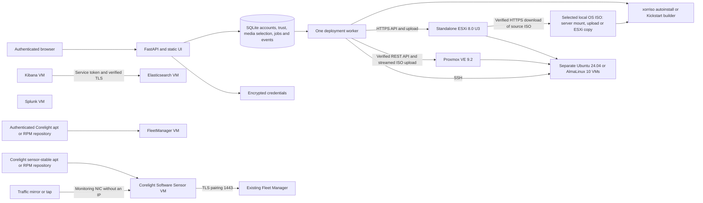

# Architecture

Deployment stages: queued → preflight → preparing media → creating VM → installing OS → installing software → verifying → completed. An exception moves the job to failed and preserves its error/events. Shutdown during work becomes interrupted on restart. Queued jobs survive restart; running jobs are deliberately not resumed because an external operation may have completed without a local acknowledgment.

The deployment detail page exposes an expandable, copyable log view. Diagnostic text is sanitized before persistence/presentation, and media-preparation failures retain bounded tool output where available. Existing entries contain only the information originally saved; a later release cannot reconstruct discarded diagnostics.

Deployment history visibility is persistent metadata in an additive `hidden_at` database column, separate from provisioning status. Administrators can hide terminal records from the default list and view them in **Deployments → Previous deployments**, or restore their normal visibility. Direct detail access, logs, encrypted credentials, VM ownership and resource reservations remain intact. Visibility updates require authentication, completed account setup and CSRF protection; queued/running/stopping/cleaning jobs cannot be hidden. Hiding performs no ESXi operations, does not retry or complete failed checks, and leaves cleanup/recovery decisions unchanged. Older releases use positional deployment inserts and cannot create jobs against this expanded schema; rollback requires the matching pre-upgrade data-volume backup.

The specification, generated credentials, virtualization-host connection snapshot and selected OS ISO path/checksum/installer profile are saved before provisioning. The remote ISO path is recorded before upload. A VM receives its UUID ownership annotation atomically as part of creation; cleanup can discover that annotation if a crash precedes saving the managed-object ID. Each mutation persists relevant state before moving to the next stage.

The first deployment wizard step requires an explicit Ubuntu or AlmaLinux choice, initially blank, alongside the software roles. All VMs in a job use that chosen profile. Setup’s displayed installer or latest media save cannot change an open draft’s OS. The deployment wizard renders a separate configuration section for every selected role, all visible together. Each maps to its own existing VM specification containing name, CPU, RAM, disk, datastore, port group and IP configuration. The deployment name labels the group. Kibana requires a separate Elasticsearch VM; selecting the pair does not combine their settings or resources. This presentation change preserves the existing per-VM API format and provisioning flow.

Selecting FleetManager adds **FleetManager configuration** after **Configure VMs** and before **Review & deploy**. The embedded configuration form reuses saved defaults and the settings API; **Save & continue** validates and saves before advancing, also updating defaults for future deployments. Review requires an explicit preflight action before queueing. Setup retains independent defaults and legacy upload cleanup. Software Sensor adds a configuration step, after FleetManager when both are selected. Jobs without either Corelight role keep the three-step wizard. FleetManager uses online repository installation only.

Recovery: failed/interrupted → cleaning → reverted + new queued deployment. A cleanup or replacement-preflight error becomes cleanup_failed and can be retried. Cleanup only deletes tagged VMs with deployment-owned storage and explicitly recorded ISO paths. It never deletes a datastore or network.

The original instance administrator remains protected; additional GUI accounts have Administrator, Credential Editor or Credential Viewer roles. All infrastructure APIs require Administrator access; credential roles access only the shared Password Manager and their own account password. Current role, enabled state and forced password change are checked on every authenticated request. Account changes revoke sessions. Auth uses scrypt password hashes, random server-side sessions with hashed cookie identifiers, SameSite/HttpOnly cookies and CSRF tokens. Secrets use authenticated Fernet encryption; ordinary API responses omit secrets. The encryption key is external to the database. Credential reveals are POST requests with CSRF verification, no-store headers and an audit event.

Password Manager stores fully encrypted entry fields and encrypted provisioning source snapshots in additive `credential_entries` records, separate from the job secrets used by the worker. Startup imports all historical jobs, including hidden ones. Job creation and credential/address updates synchronize entries in the same transaction; a field-by-field merge preserves saved user overrides. Revision checks prevent stale edits/deletes from overwriting newer values. Provisioned-entry deletion retains a secret-free tombstone to prevent automatic reimport. Lists omit secrets and notes; an explicit audited reveal retrieves them. Section names live in additive encrypted `credential_sections` records. Optional section IDs and normalized tag lists live inside each encrypted entry, outside provisioning source snapshots so synchronization preserves organization. A revision-checked organization PATCH does not expose secrets. Section removal atomically clears its active entry references and increments their revisions, retaining passwords/keys/tags and original worker secrets. Catalog reads use a consistent transaction for labels, counts and entries. Organization labels do not alter the shared RBAC boundary. Additional accounts are held in `gui_users` with scrypt hashes, fixed roles and mandatory replacement of temporary passwords. The original singleton account is retained for upgrade compatibility. See [Password Manager](PASSWORD_MANAGER.md).

The HTTPS deployment connection snapshot is encrypted with each job so changing Setup does not redirect existing work or recovery to a different ESXi host. Changed credentials for the same host may require operator intervention if an old job's snapshot is no longer valid.

Setup groups virtualization hosts, OS installation media, software packages and SSH access in separate tabs. The media form’s OS installer selector edits the independent verified ISO default for Ubuntu autoinstall or AlmaLinux 10 Kickstart; the deployment wizard chooses which default a job uses. The media tab is directly addressable at `#settings/media` and opens by default when the host is configured but no ISO is ready. Administrators can browse the saved ESXi host's datastores and folders for an existing ISO, select an existing `.iso` from the read-only `/media` server mount, or stream a browser upload. Browser uploads and ESXi downloads are stored in `/data/media` in the persistent data volume. The administrator supplies the publisher's verified SHA-256; GDeploy checks it and OS-specific metadata before saving the selection. Failed validation retains the previous selection. Authentication, completed account setup and CSRF protection are required for media mutations.

ESXi browsing and downloads use the saved standalone-host credentials and the same certificate verification as provisioning. A browse selection is bound to its host so changing the saved endpoint requires a fresh selection. Datastore browsing requires `Datastore.Browse` and download access to the selected file. Downloads are bounded to 16 GiB and checked against available local disk capacity. GDeploy saves a local working copy and its origin host/datastore/path with `source="esxi"`; the original datastore file is not modified or deleted. The local copy is retained for later deployments and survives restarts. The selected Ubuntu autoinstall or Alma Kickstart builder remasters that copy into each deployment's separate installation ISO.

The additive `media_profile_settings` table stores an encrypted approved ISO snapshot per installer profile. Existing approved selections migrate without discarding the legacy singleton `media_settings` pointer, old media, jobs or credentials. The singleton continues to represent the most recently saved selection for older clients; catalog/profile queries and `media.selected(profile)` resolve only matching saved media. Public per-OS readiness metadata omits local filesystem paths. No directory listing or filename automatically approves a profile.

A saved selection takes precedence over environment-configured media for that same profile. `GDEPLOY_OS_ISO`, `GDEPLOY_OS_SHA256` and `GDEPLOY_OS_PROFILE` are the preferred environment names; the default profile is `ubuntu-autoinstall`, and Alma uses `alma10-kickstart`; the legacy `GDEPLOY_UBUNTU_ISO` and `GDEPLOY_UBUNTU_SHA256` names remain compatible. Existing installations use the environment fallback only for its configured profile until a matching saved selection exists. **Clear saved selection** removes only the displayed OS default without deleting the source file or the other OS default, restores a matching environment fallback when configured, and leaves active deployment snapshots and deletion protection intact. Profile-scoped GET/DELETE media requests preserve the legacy no-profile current-selection interface. This permits clearing and then deleting a sole unused managed copy without first uploading another. Uploaded/imported media belongs in the complete data-volume backup; server-mounted source media is backed up separately.

New jobs resolve the explicit requested profile’s verified local ISO and snapshot its path, checksum and installer profile so later Setup changes cannot switch media for queued or running work. They still require the local source file to remain available and unchanged. Once an ESXi import finishes, subsequent changes to the original datastore file do not alter its saved copy. Delete/redeploy resolves and verifies the saved media for the original installer profile before deleting resources, then freezes that verified selection for the replacement. Supported profiles are Ubuntu Server 24.04 LTS amd64 live-server and AlmaLinux 10 standard x86_64 full DVD. Existing Ubuntu media and job snapshots retain Ubuntu behavior. Media changes apply to future jobs for that same OS. Missing, changed or mismatched requested media fails before creation; the other profile is never substituted. An open wizard retains its chosen OS while Setup changes, and OS changes invalidate preflight.

Storage reporting uses the filesystem containing the configured data directory, normally `/data`, as seen by the container. It reports that filesystem's total, used and available bytes alongside sizes of managed ISO copies and deployment work. It does not enumerate unmounted host disks, impose a data-volume quota, or resize the host filesystem. The default named volume uses the backing filesystem's available capacity; the separate `/tmp` tmpfs remains limited to 256 MiB.

The installer writes temporary files beneath its private workspace in `/data/artifacts` and supplies that directory as subprocess `TMPDIR`. Extracted GRUB and manifest files can preserve the ISO's read-only mode, so the builder makes those private working copies writable before patching. The selected source ISO remains unchanged. This work runs as the existing non-root container account and uses disk-backed data storage rather than the small `/tmp` mount.

Authenticated administrators can delete registered browser-uploaded or ESXi-imported ISO copies. Deletion is checked against every saved profile selection, the legacy pointer, and queued/running/stopping/cleaning deployment snapshots, and serialized with selection and deployment insertion. It refuses protected files and does not follow replacement symlinks or arbitrary paths. It removes only an eligible managed copy and its registry entry, records an audit event, and leaves deployment history intact. Server-mounted sources and original ESXi files are outside this API. A missing unprotected managed file can have its stale registration removed without touching unrelated files.

ESXi certificate retrieval returns the peer certificate's subject, issuer, SHA-256 fingerprint, validity dates and subject alternative names for operator review. The administrator explicitly approves the certificate for that exact host endpoint after comparing its fingerprint with an independently trusted ESXi source. The fetched certificate by itself is not proof of host identity.

Approved certificates are persisted in an additive SQLite trust table. Each new ESXi client looks up the current approval for the endpoint it will connect to, including the host saved in an older deployment snapshot. Certificate approvals are not copied into deployment snapshots. Both the API transport and datastore HTTPS downloads/uploads enforce the exact approved leaf certificate and its valid dates on their connections. Endpoint-specific approval permits a hostname/SAN mismatch; without an approval, normal system/private CA and hostname verification applies. A changed or renewed certificate requires explicit review and replacement of the approval.

Trust removal restores CA-based verification. Trust updates affect subsequent connections; existing authenticated connections may finish with their already-verified certificate. Container restart is unnecessary, and approved certificates survive restart in the same app data volume. Backups must include the trust table. Application versions before **0.2.0** ignore the table and use their previous TLS settings, which can include a saved `verify_tls=false`. Before rollback, review those settings and ensure certificate verification is enabled and trusts the intended host.

SSH access settings store validated administrator public keys in a separate encrypted SQLite record. Settings mutations require administrator authentication, completed account setup and CSRF protection. Each new deployment captures the current list in its encrypted secrets; the worker uses that snapshot for every VM and never substitutes later settings. Ubuntu autoinstall or Alma Kickstart receives these keys along with the VM's unique automation public key for the `gdeploy` account. Key input is parsed as OpenSSH public-key data, not interpolated into shell commands. Ed25519, RSA of at least 2048 bits and supported ECDSA keys are accepted; duplicate key material is removed. Private keys, certificates, authorized-keys options, malformed encodings and control-character injection are rejected without echoing input.

Saving or clearing the default key list does not contact existing guests. Jobs created before this feature have no administrator-key snapshot and keep their prior behavior. A replacement created by delete-and-redeploy captures the current list. The settings table and deployment snapshots belong in complete data-volume backups. Older app versions ignore these administrator keys, including snapshots on queued jobs; finish queued work before rollback. Generated automation keys, password access and guest sudo behavior are unchanged.

## AlmaLinux installer and guest dispatch

Alma media validation reads internal `.treeinfo` and verifies release 10, standard x86_64, kernel/initrd/stage2, local BaseOS/AppStream metadata and both GRUB menus. Boot/minimal/netinstall/live and x86_64_v2 media are rejected. Xorriso replays the original DVD label and BIOS/UEFI boot metadata; the source remains unchanged. The private Kickstart installs SSH, VMware Tools, Python, sudo, NetworkManager and firewalld from the full DVD. Required firmware/boot partitions, bounded swap and an uncapped growing XFS root avoid a capped sensor root volume. The `gdeploy` user has password sudo and captured administrator/automation public keys; root is locked and root SSH is disabled. Host keys are generated and SELinux contexts restored before SSH validation. SELinux remains enforcing.

Sensor Kickstart activates only management by its MAC. Kernel interface names, systemd `.link` files and MAC-bound NetworkManager profiles preserve `gdeploymgmt` and nonaddressed `gdeploymon` after reboot; the installer rebuilds initramfs. A root-owned mode-0600 completion marker is written only after post-install setup succeeds. Alma readiness verifies that marker, installed Alma 10 disk root, hostname, sudo and active `sshd`/`vmtoolsd`; Ubuntu retains its cloud-init evidence checks. Application dispatch selects DNF/RPM, firewalld and SELinux setup for Alma while preserving existing Ubuntu flows. ESXi 8.0 U3 uses its RHEL-family guest identifier, EFI and VMXNET3; this does not establish Alma 10 VMware certification. See [Alma acceptance and recovery](ALMALINUX.md).

## FleetManager

FleetManager is a fifth optional VM role alongside OS only, Splunk, Elasticsearch and Kibana. Its own VM specification requires at least 2 vCPUs, 8 GiB RAM and 60 GiB disk; the UI defaults to 80 GiB disk. The Ubuntu direct layout and Alma growing XFS root use the full disk, with `/var` and `/tmp` normally sharing the root filesystem. Guest checks validate 30 GiB free at `/var` and 20 GiB free at `/tmp` before installing Fleet Manager.

`FleetManager` manages encrypted `fleetmanager_settings` and `fleetmanager_files` records. Its authenticated settings API exposes readiness flags, package metadata and license name/checksum/expiry. Community strings, repository tokens and raw PEM/private-key data are omitted from ordinary responses. Saving validates the product identity PEM's first certificate, matching unencrypted private key and dates; actual Corelight product entitlement is checked by the guest application. Blank fields retain existing secrets. Clearing defaults does not contact guests or delete registered packages.

Settings contain the community string, license PEM, repository token and separate Debian/RPM online version choices. Ubuntu configures the Corelight stable apt repository, downloading the signing key over verified TLS with bounded HTTPS redirects and permanently stripping authentication after an origin change. Root-only apt credentials and repository configuration remain for administrator-managed upgrades. Ubuntu package operations preserve existing guest configuration using `--force-confold`. Alma uses the documented fleet-stable rpm_any repository, protected DNF configuration, signed repository metadata and exact RPM selection. Alma 10 Corelight installation remains experimental because the supplied guide documents Alma/RHEL 8 and 9.

New jobs snapshot these settings in encrypted secrets. Preflight and worker validation use that snapshot rather than later Setup edits. Offline settings are rejected before provisioning, including snapshots queued by earlier releases; there is no automatic conversion to a network install. Legacy defaults remain readable with a migration error and retain valid license metadata and secret flags. An explicit online save can reuse those secrets and removes obsolete package references without deleting the files.

New `.deb` uploads and offline guest package installation are disabled. Existing `fleetmanager_files` records and managed files remain available for cleanup, retaining path, ownership and active-reference protections. Mounted files cannot be deleted through the API. This compatibility path preserves old deployment history and resources without offering offline installation in Setup or the wizard.

The Ubuntu guest installs UFW if needed, adds persistent TCP 443/1443 allow rules, and checks that both rules are saved without resetting or enabling the firewall. It preserves existing SSH access rules and policy. Alma enables firewalld and adds/verifies persistent and runtime TCP 443/1443 plus SSH in the management interface’s zone, preserving unrelated rules. The guest writes `/etc/corelight-fleetd.conf`, installs the product identity PEM at `/etc/corelight-fleetd.pem` with ownership `corelight-fleetd` and mode 0400, and enables the `corelight-fleetd` service. Readiness verifies active systemd state, HTTPS on loopback port 443 pinned to the supplied leaf certificate, and a listening sensor port 1443. It does not simulate sensor authentication. Fleet Manager generates a temporary `admin` password; the encrypted result and community string are available through the authenticated Credentials reveal, with password replacement required at first Fleet Manager sign-in. Sensor enrollment, live guest upgrades and subsequent credential rotation are outside GDeploy's provisioning workflow.

Complete data-volume backups include encrypted FleetManager configuration and any retained legacy dependency packages. Back up mounted media and guest application data separately. Older GDeploy releases do not support the FleetManager role; finish or resolve those jobs before rollback. Clearing settings or updating GDeploy never updates the configuration/license already installed inside a VM.

An actual host/guest lab is required to establish integration compatibility. No simulated deployment mode is exposed to users, and production success is only reported after OS and application checks return successfully. FleetManager's API and installer tests do not establish live Corelight license, real vendor package, sensor or ESXi compatibility.

## Corelight Software Sensor

The `corelight_sensor` role installs on fresh minimal Ubuntu 24.04 or experimental AlmaLinux 10. Encrypted common settings contain repository token, required sensor license key, community string, Fleet pairing URL/SSL name and API network. The unique pairing token is request-only input to preflight, queue and sensor redeploy; it is stripped before storing the public specification and saved only in encrypted job secrets. Ordinary responses expose saved flags, not secrets.

A persistent keyed token fingerprint is reserved transactionally with job insertion. Unrelated jobs cannot reuse it, including tokens from failed/stopped jobs. Preflight reports prior use and queueing rechecks atomically. For direct recovery only, a blank token reuses the original encrypted sensor snapshot when installation demonstrably never started. A fresh replacement token uses current Setup settings. Both paths validate and freeze the snapshot before destructive cleanup. Ordinary responses expose only `sensor_pairing.can_reuse` and a fixed explanation; the saved token never returns to the browser. GDeploy does not alter Fleet records.

The additive `sensor_installation_state` table records the sensor installation boundary separately from mutable job and VM snapshots. It becomes started before invoking the sensor guest installer and cannot be reset by normal completion, failure, stop or restart handling. Legacy jobs use the sensor VM's own pre-installation status as conservative evidence, not a job-wide stage that could belong to another role. Unknown or later sensor states require a fresh token.

The additive `sensor_redeployments` table reserves one replacement operation and an encrypted sensor snapshot before cleanup. Pending fingerprints are unavailable to unrelated jobs; cleanup failures retain their reservation for recovery. Replacement insertion, any transfer of the original token reservation and the parent transition to reverted commit atomically. This preserves token ownership through repeated early failures and prevents concurrent recovery from producing multiple replacements. Back up both tables with the complete data volume and original encryption key; finish or resolve queued/running work before rolling back to an older worker that does not track these boundaries.

Sensor VMs are created with two VMXNET3 adapters and without installation media before ISO preparation. GDeploy supplies distinct `addressType="manual"` MACs from VMware's `00:50:56:00:00:00`–`00:50:56:3f:ff:ff` range, excluding registered VM addresses on the target host. This removes the dependency on standalone ESXi generating MACs before first power-on. Allocation is bounded; adapter readback still verifies ownership, device keys, type, valid distinct unicast MACs and powered-off state. It does not probe for IP conflicts or provide a LAN-wide MAC registry. Ordinary VM roles keep generated MACs.

The sensor's initial boot order references only the disk; ESXi rejects a CD/DVD boot entry when no corresponding drive exists. Owned VM IDs and actual NIC MACs are persisted, and resolved MACs are logged with their management/monitoring roles. MAC-specific Ubuntu netplan or Alma NetworkManager profiles assign an IP address only to management; monitoring disables DHCP, RA and link-local addressing. After ISO upload, one powered-off reconfiguration adds both the CD/DVD drive and disk-first/CD boot order using the actual ESXi disk key. The VM is then powered on; a blank disk falls through to the installer, while the installed OS boots from disk after reboot. There is no preliminary boot to acquire MACs. Ordinary ownership-based recovery remains available if MAC verification or media creation/upload fails; these errors precede the sensor installation/token-use boundary.

Host capacity/reservations and guest resource checks enforce the sensor profile where observable. Guest checks require Ubuntu 24.04 or AlmaLinux 10, x86-64-v3 CPU capabilities and 500 GB free space. SSD backing, actual traffic mirroring and throughput still require site verification. The installer configures the fixed sensor-stable repository over verified HTTPS with bounded redirects and root-only apt credentials or Alma RPM configuration, installs vendor packages and writes the documented `sensor` YAML subtree. It runs Corelight prepare/deploy/status commands. Alma uses the documented EL9 and rpm_any sensor repositories with signed repository metadata; no EL10 repository is invented. Kubernetes CNI owns the sensor firewall after competing host firewalls are disabled; FleetManager application rules are not applied.

Readiness requires healthy sensor services including licensed sensor-core and connection-manager. It does not prove packet visibility or correct Fleet policy/export settings. The documented Suricata no-rules warning is surfaced without ignoring unrelated failures. All diagnostics must redact sensor secrets. Real licensed installation, ESXi/Fleet pairing and mirrored-traffic acceptance remain a lab exercise.

Version v0.16.1 retains existing Ubuntu/Alma job snapshots and the original encryption configuration. Rollback to v0.16.0 ignores the additive per-profile table and sees only the most-recent legacy media pointer. Finish or resolve active work and verify that pointer’s supported media before rollback; keep a complete matching backup. No app rollback reverses guest changes or pairing-token use.

## Named virtualization targets

The additive encrypted `target_hosts` table stores named ESXi/Proxmox endpoint credentials, provider and host defaults. The existing singleton ESXi settings remain a synthetic `legacy-esxi` target; old APIs and queued jobs retain their behavior. New specifications carry a target ID; queueing records public target metadata and an encrypted immutable connection snapshot. Worker/recovery dispatch uses that snapshot, including Proxmox node and ISO storage, rather than later Setup values. VM-name, CPU and RAM reservations are scoped to the endpoint/node; static IP reservations remain global advisory checks.

The Proxmox adapter uses verified HTTPS on port 8006 by default, API tokens or renewable password tickets, bounded task polling, streamed multipart ISO uploads and QEMU/VirtIO configuration. Endpoint-specific leaf approvals use the existing encrypted trust table with distinct host/port keys. Preflight checks effective user/token permissions, bridges, disk stores and separate ISO storage. Both OS installers select QEMU Guest Agent and provider-matching readiness checks on Proxmox while retaining VMware Tools on ESXi. Shared application installers remain OS-specific.

Proxmox cleanup requires full VM audit visibility, UUID descriptions, ownership-validated disks/ISOs, a configuration recheck and cluster attachment checks against current VM configuration. It never requests unreferenced disk deletion. Proxmox has no ISO byte-download endpoint here: uploaded/mounted local sources are remastered before uploading temporary media; optional SSH import is outside this release. See [Proxmox setup, permission and validation boundaries](PROXMOX.md).

## Splunk media selection in the deployment wizard

Splunk adds Installation media after Configure VMs and before Corelight configuration or review. Reused ISO/package panels are scoped to the draft OS and target, with distinct element IDs. Media is verified through the existing authenticated settings APIs before continuation; pending files/checksums remain in the open tab across Back/resource corrections and are discarded on close/sign-out. Review identifies both files; media preflight actions return to this step. Setup retains independent management controls.

The additive encrypted `splunk_package_format_settings` table preserves approved DEB, RPM and TGZ defaults. The legacy singleton remains the most recently saved package for older clients. Profile-scoped catalogs and worker queueing resolve the matching native default, matching native environment fallback, saved TGZ, then TGZ environment fallback. A broken saved native default is reported rather than silently replaced. All saved defaults and active snapshots protect uploaded files from deletion. Each queued job still captures its package and checksum; later settings cannot switch it. Wizard ESXi browse/import requests carry the selected target ID and recheck its endpoint; Proxmox uses local/uploaded ISOs.
